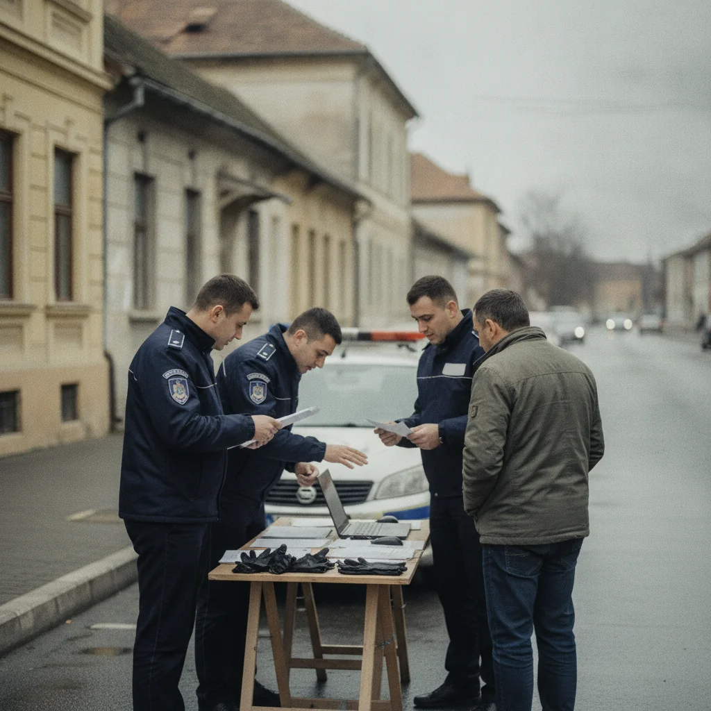

# Motru: 7,8 kg canabis în colet camuflat, dosar cu legătură în Spania

Municipiul Motru a fost scena unei acțiuni DIICOT în care un bărbat de 32 de ani ar fi ridicat un colet cu 7,8 kilograme de canabis, pregătit pentru vânzare. Dosarul implică și un membru de familie de 34 de ani, aflat în Spania, care ar fi procurat și expediat drogul.

## Reținere după flagrant

Pe 4 noiembrie 2026, procurorii DIICOT – Biroul Teritorial Gorj au dispus reținerea inculpatului de 32 de ani, cercetat pentru trafic internațional de droguri de risc și trafic de droguri de risc. Reținerea a avut loc după ce, în aceeași zi, inculpatul ar fi fost surprins în flagrant în Motru, în timp ce prelua coletul cu canabis.

Cantitatea totală indicată în comunicat este de 7,8 kilograme. Anchetatorii susțin că marfa urma să fie comercializată pe piața locală după livrare.

## Expediere din Spania și ascunderea în colet

Potrivit probatoriului, drogul ar fi fost procurat și trimis de inculpatul de 34 de ani, rudă a celui reținut, aflat pe teritoriul Spaniei. În colet, canabisul ar fi fost pus în opt pungi vidate și ascuns printre pachete cu dulciuri, sucuri, conserve, sticle de ulei și mezeluri.

Polițiștii Serviciului de Combatere a Criminalității Organizate Gorj au participat la activitățile judiciare alături de procurori. Dosarul rămâne deschis, iar instanța este sesizată cu propuneri de măsuri preventive.

## Tribunalul Gorj, sesizat astăzi

La 5 noiembrie 2026, procurorii au înaintat Tribunalului Gorj propunerea de arestare preventivă pentru inculpatul de 32 de ani și de arestare în lipsă pentru inculpatul de 34 de ani. Deciziile aparțin judecătorului de drepturi și libertăți.

Potrivit precizărilor din comunicat, pe parcursul procesului penal persoanele cercetate beneficiază de drepturile și garanțiile procesuale prevăzute de Codul de procedură penală, precum și de prezumția de nevinovăție.

## Rolul SCCO Gorj și pașii următori

Comunicatul DIICOT precizează că activitățile judiciare au fost realizate împreună cu polițiștii Serviciului de Combatere a Criminalității Organizate Gorj. Coordonarea între parchet și structurile de poliție judiciară a permis documentarea momentului flagrant și a modului în care coletul a ajuns în Motru.

Dacă instanța va admite propunerile de arest preventiv și de arestare în lipsă, inculpații vor putea formula căile de atac prevăzute de lege. Pentru inculpatul aflat în Spania, procedura de arestare în lipsă deschide etape distincte de cooperare judiciară, în funcție de regulile aplicabile dosarelor penale internaționale.

Anchetatorii pot continua audierile, expertizarea substanțelor ridicate și verificarea fluxului financiar legat de expediere. Orice alte persoane implicate pot fi identificate pe măsură ce probatoriul se completează, fără ca DIICOT să fi anunțat public alte măsuri în afara celor menționate în comunicatul din 5 noiembrie 2026.

## Surse

- https://www.diicot.ro/mass-media/6774-comunicat-de-presa-8-05-11-2026
